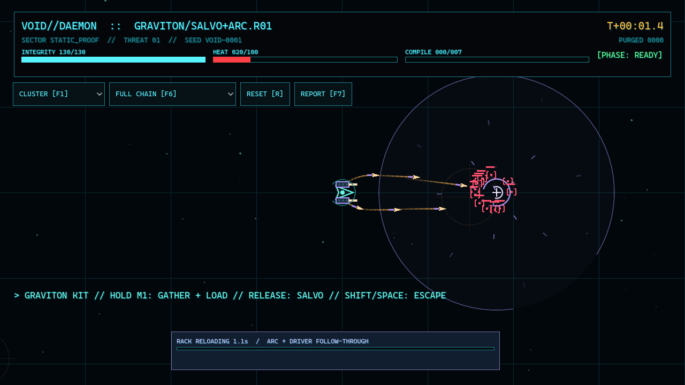
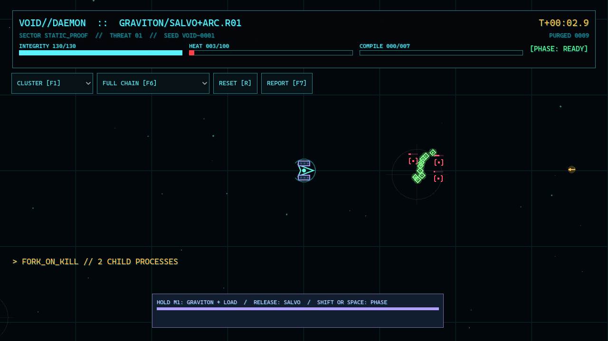
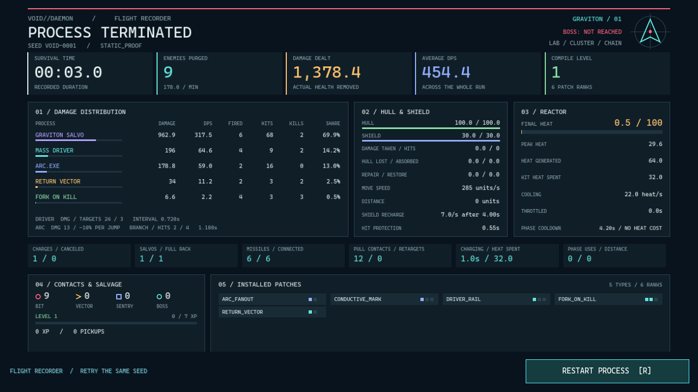
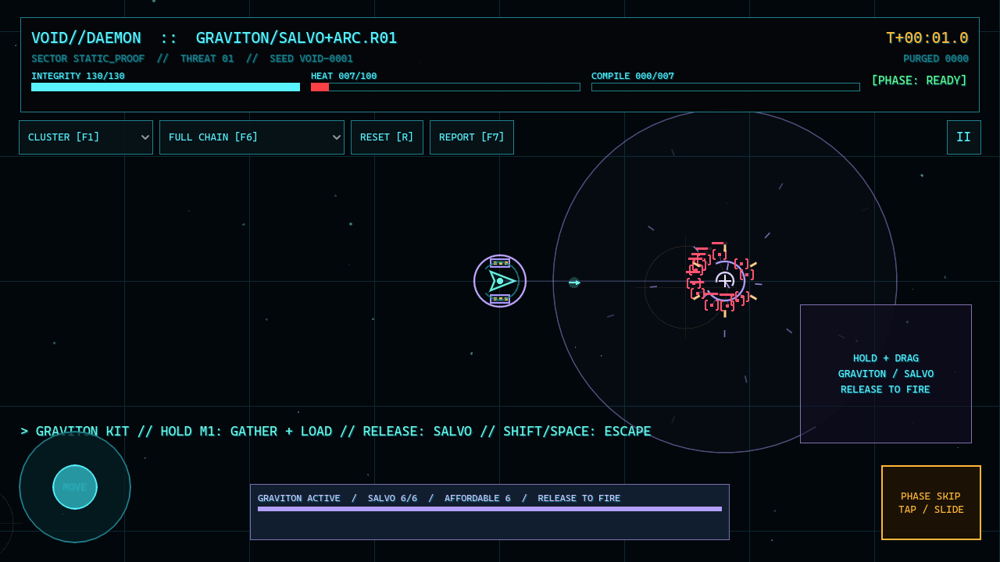
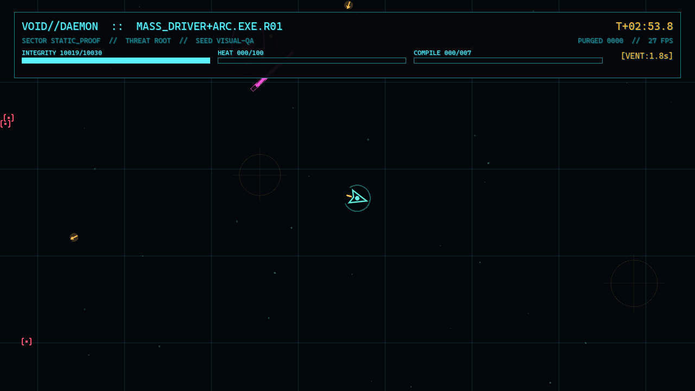
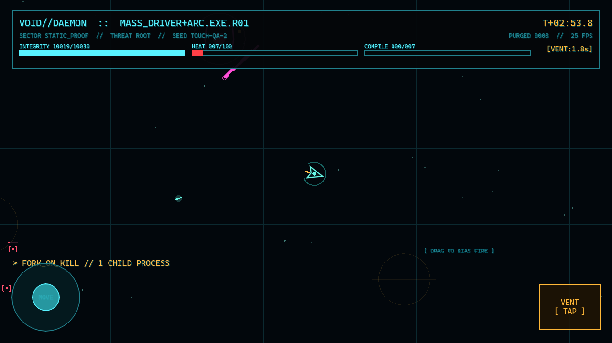
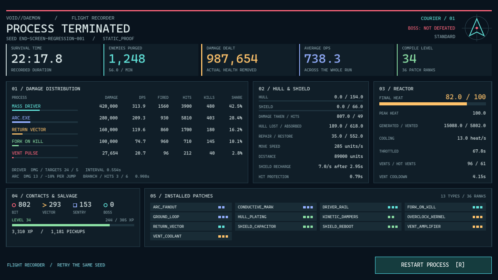

# VOID//DAEMON — playable Godot prototype



🎬 **[Watch Gameplay Trailer](artifacts/void_daemon_trailer.mp4)** — 30-second highlight reel featuring autonomous weapon processes, patch evolutions, thermal reactor venting, and swarm combat.

This repository contains an executable combat proof. The current kit combines an offensive graviton field with a charged missile salvo, followed by automatic ARC and driver processes. Holding M1 gathers enemies and loads the rack; release launches the salvo. Shift/Space provides a separate phase escape.

**Start the example:** `play_combo_lab.cmd` opens Cluster + Full Chain, with selectable encounters and loadouts. See [Graviton playtest instructions](PLAYTEST_GRAVITON.md). `play_classic.cmd` retains the previous automatic-weapon/VENT mode; a pre-change source archive is also preserved in `artifacts/`.

The prototype uses Godot 4.7.1, GDScript, code-drawn visuals, and procedurally synthesized audio — **zero external asset dependencies**.

On a fresh clone, install Godot 4.7.1 and open `project.godot`; the portable engine in `.tools/` is intentionally not tracked. The Windows wrappers expect its executables under `.tools/godot/`. With an installed Godot on your PATH, launch the lab directly with `godot --path . -- --combo-lab --fixture=cluster --loadout=chain`.

## Run it

On Windows, the execution-policy-free launcher is:

```text
run_game.cmd
```

The first argument is a seed; pass `touch` as the second argument to preview mobile controls:

```text
run_game.cmd SIGNAL-42 touch
```

From PowerShell, if local script execution is enabled:

```powershell
.\run_game.ps1
```

Run a repeatable seed:

```powershell
.\run_game.ps1 -Seed "SIGNAL-42"
```

Preview the mobile controls on desktop:

```powershell
.\run_game.ps1 -Seed "TOUCH-42" -Touch
```

You can also open `project.godot` in Godot and press **F6/F5**.

## Controls

### Mouse and keyboard

- `WASD` or arrow keys: move.
- Mouse position: bias both weapon processes toward that direction.
- Hold `M1`: graviton gathering field + charge up to six missiles; release to launch.
- `Shift` or `Space`: phase skip, canceling an uncommitted charge. Shield regenerates passively.
- In the lab, `F1–F3` choose encounters, `F4–F6` choose loadouts, `R` resets, and `F7` opens the scorecard. The selectors and Report button also work by mouse/touch.
- Classic mode uses `Space` or right mouse for `VENT` instead of the Graviton kit.
- `1`, `2`, `3` or mouse: choose an upgrade.
- `T`: show/hide the touch layer for desktop testing.
- `F10`: debug-skip to the boss.

### Controller

- Left stick: move.
- Right stick: bias fire.
- Right trigger: hold/release Graviton + Salvo.
- `A` or right shoulder: phase skip (`VENT` in classic mode).
- Upgrade cards use normal controller focus and accept input.

### Mobile touch

- Lower-left virtual stick: move.
- Hold/drag the right action pad: gather and aim; release to launch the salvo.
- Lower-right `PHASE SKIP`: escape. Slide from the held action pad into it to cancel first and escape without firing.
- `II` pauses. Shield is passive. Classic mode retains right drag-to-bias and the `VENT` button.
- Tap upgrade cards directly.

The touch layout observes the platform safe area and the project is locked to landscape orientation.

## What is implemented

- An integrated Graviton/Salvo kit: live bounded pull during charge, six-cell rack animation, staggered homing missiles, falloff splash, per-launch/source telemetry, charge sound, impacts, and independent phase skip.
- A combat lab with fixed cluster, dispersed, and boss encounters; salvo/gravity/full-chain comparisons; reset and report controls. The room waits for the first hold.

- A five-minute escalating survival phase followed by `WATCHDOG_01`, a multi-pattern boss.
- `MASS_DRIVER`: selects dense lines and fires piercing rounds.
- `ARC.EXE`: chains between nearby contacts.
- Thirteen ranked upgrade definitions, including:
  - `FORK_ON_KILL`;
  - `RETURN_VECTOR`;
  - `DRIVER_RAIL`;
  - `CONDUCTIVE_MARK`;
  - `ARC_FANOUT`;
  - `GROUND_LOOP`;
  - heat, shield, hull, and `VENT` patches.
- Deterministic upgrade offers and spawn/visual rolls derived from the displayed run seed.
- `BIT`, `VECTOR`, and `SENTRY` enemy roles with distinct glyphs, movement, and telegraphs.
- Shield, hull, reactor heat, throttling, cooling, `VENT`, XP collection, leveling, and end-of-run telemetry.
- Wide visual run scorecard: headline survival/kills/damage/DPS/level, weapon contribution bars and exact totals, hull/shield and reactor panels, enemy-type totals, XP progress, a complete grid of upgrade ranks, and kit activity. Desktop shows the entire card at once with no scrolling. Small screens use fixed tabs (Run, Arsenal, Systems, Build, plus Kit in Graviton mode), selectable by touch, numbered keys, or controller focus; Restart stays visible. Damage excludes overkill and includes missiles, ARC, VENT, forks, and return rounds.
- Terminal HUD, responsive upgrade modal, restart flow, seed display, boss warning, and touch controls.
- Code-only vector/glyph presentation, arc effects, vent rings, stars, grid, and seeded anomaly marks.
- Procedurally generated synth cues for weapons, damage, `VENT`, upgrades, boss arrival, victory, and death.
- A runtime smoke mode that exercises all enemy roles, both weapons, several patches, the boss, friendly/hostile projectiles, pickups, and touch-safe UI construction.

## Validate it

```powershell
.\test_game.ps1
```

Or use the execution-policy-free wrapper:

```text
test_game.cmd
```

Expected runtime markers:

```text
SMOKE_CONTRACTS_OK deterministic_offer=[...]
SMOKE_START ... boss=true
SMOKE_OK ... hostile=... boss_health=...
RUN_REPORT_OK ...
```

The test first asserts that a seed and build state return three deterministic, unique upgrade cards. It then uses the portable Godot console build for a five-second integrated combat simulation.
The run-report regression test also checks exact damage across all five sources, overkill, boss killing-hit credit, shield/hull accounting, rejected hits/vents, XP, scorecard snapshots, no-scroll layout bounds, and compact-page controls at desktop and phone sizes.
The Graviton checks additionally compare real clustering against a no-field control, verify splash/heat/cancellation/touch input, and run a complete mouse-input sequence that observes missile damage followed by ARC damage. Physical phone/controller validation and human fun judgement remain playtest work.

## Screenshots

### Current Graviton kit and scorecard




### Earlier classic-mode desktop gameplay


### Earlier classic-mode touch controls


### End-of-run telemetry


Regenerate the long-build end-screen regression capture with:

```text
.tools\godot\Godot_v4.7.1-stable_win64.exe --path . -- --capture-end-screen
```

Add `--capture-size=360x640 --capture-page=1` after `--capture-end-screen` to render a compact page (0: Run, 1: Arsenal, 2: Systems, 3: Build). The fixture includes all thirteen patches to catch overflow.

## Project layout

```text
src/
├── main.gd                    Run orchestration, input, spawning, XP, boss, FX
├── actors/
│   ├── player_ship.gd         Device-agnostic ship movement, hull/shield/heat
│   ├── enemy.gd               BIT, VECTOR, and SENTRY behavior
│   ├── projectile.gd          Shared player/enemy projectile actor
│   ├── watchdog_boss.gd       Prototype boss
│   └── xp_orb.gd              Attraction and collection
├── systems/
│   ├── upgrade_catalog.gd     Seeded offer catalog
│   └── weapon_controller.gd   MASS_DRIVER/ARC.EXE behavior and patch logic
├── ui/terminal_hud.gd         HUD, upgrade/end modals, touch controls
├── audio/synth_audio.gd       Procedurally generated SFX cues
└── world/arena_backdrop.gd    Seeded code-drawn arena presentation
```

## Intentional prototype limits

- The arena is static; the seed currently controls its decoration, spawn sequence, and upgrade candidates, not procedural collision geometry.
- There is no meta progression, route system, save migration, online service, or commercial scaffolding.
- Enemy counts target readable combat rather than the old 1,000-enemy planning number.
- `COMPILE` evolutions remain out until the process/patch loop proves fun in play.
- Android/iOS export templates and signing toolchains are not installed, but the runtime input/UI path is touch-native rather than mouse emulation.

The right next step is playtesting, not adding breadth. Watch whether gathering and releasing the salvo feels responsive and worthwhile, whether partial salvos and phase escapes create choices, and whether `FORK_ON_KILL`, `RETURN_VECTOR`, and `ARC_FANOUT` change positioning. Human fun judgement and physical phone/controller validation remain open.
